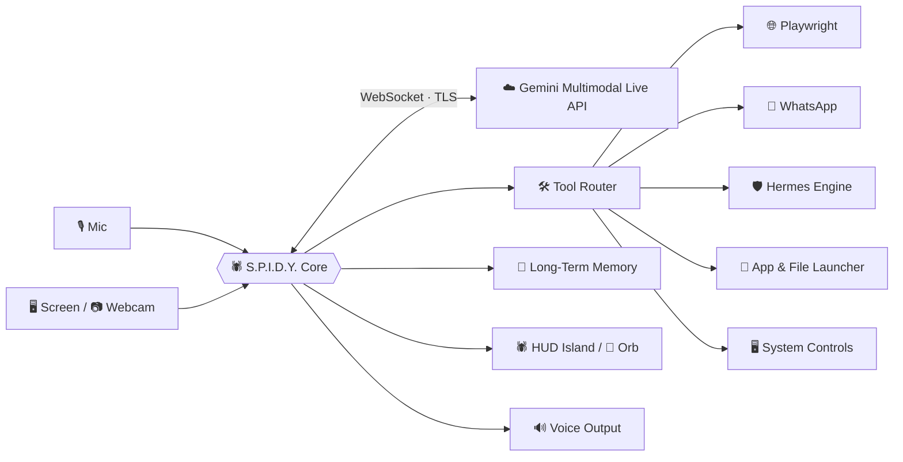

<div align="center">


<a href="https://github.com/Abhayp56/SPIDY-AI">
  
</a>

<br/>


[](https://github.com/Abhayp56/SPIDY-AI/stargazers)
[](https://github.com/Abhayp56/SPIDY-AI/network/members)
[](https://github.com/Abhayp56/SPIDY-AI/issues)
[](https://github.com/Abhayp56/SPIDY-AI/commits)

**[Quick Start](#-quick-start)** •
**[Features](#-features)** •
**[Voice Commands](#-voice-commands)** •
**[How It Works](#-how-it-works)** •
**[Roadmap](#-roadmap)**

</div>

---

## 🕸️ What is S.P.I.D.Y.?

**S.P.I.D.Y. AI** is a real-time, low-latency, multimodal desktop companion built on Google's **Gemini Multimodal Live API**.

It **hears** your voice, **sees** your screen or webcam, **understands** natural instructions, **executes** multi-step computer tasks, and **talks back**, all from a sleek holographic bar floating at the top of your desktop.

> 🎙️ *"Spidy, look at my screen and tell me why this build is failing."*
> 🕷️ *"On it. The error is a missing import on line 42. Want me to fix it?"*

No subscriptions. No middleman. Just you, your PC, and your own Gemini API key.

<!-- 📸 Add a demo GIF here for maximum impact:
<div align="center"></div>
-->

---

## ✨ Features

<table>
<tr>
<td width="50%" valign="top">

### 🕷️ Holographic HUD Island
A sleek 44px floating bar with a vector Spider avatar, mute control, and a dual-tone **scarlet + electric cyan** soundwave that reacts to your mic and its voice.

- **Auto-hide** collapses to a micro-notch when silent
- **Voice-reactive** expands the moment you speak
- Glowing cyan eyes, crimson accent arc, neon outer glow

</td>
<td width="50%" valign="top">

### 🔮 Ambient Desktop Orb
Prefer something minimal? Switch to a pulsing energy orb that sits anywhere on your screen and **remembers its position**.

- Toggle between Island and Orb at any time
- Same brain, different vibe

</td>
</tr>
<tr>
<td width="50%" valign="top">

### 🎙️ Real-Time Voice Streaming
Ultra-low-latency, bidirectional audio over WebSockets using the Gemini Multimodal Live API. Talk naturally, interrupt it, and it keeps up.

</td>
<td width="50%" valign="top">

### 👁️ Visual Intelligence
Live screen capture and webcam inspection. Ask it to analyze error dialogs, IDE code, websites, or images.

</td>
</tr>
<tr>
<td width="50%" valign="top">

### 💬 WhatsApp Automation
Headless WhatsApp integration. Read unread messages, look up saved contacts by name, and send replies, hands-free.

</td>
<td width="50%" valign="top">

### 🌐 Live Web Automation
Built-in **Playwright** browser control to navigate sites, click elements, fill forms, and search the web.

</td>
</tr>
<tr>
<td width="50%" valign="top">

### 🛡️ Autonomous Problem Solving
The integrated **Hermes** execution engine handles multi-step terminal commands, script execution, and workspace automation.

</td>
<td width="50%" valign="top">

### 📂 Smart App & File Launcher
Open files, folders, or whole workspaces in your preferred app: *"Open my project in AntiGravity"*, *"Open notes in VS Code."*

</td>
</tr>
<tr>
<td width="50%" valign="top">

### 🌤️ Voice Weather & News
Spoken weather and news summaries, delivered aloud without forcing open browser tabs.

</td>
<td width="50%" valign="top">

### 🧠 Persistent Long-Term Memory
Remembers facts about you, your preferences, and your projects across reboots.

</td>
</tr>
</table>

<div align="center">

### ⌨️ Global Hotkeys
Press **`Ctrl` + `Space`** or **`Ctrl` + `A`** anywhere in Windows to wake, command, or expand instantly.

</div>

---

## ⚙️ How It Works



---

## 🚀 Quick Start

### Prerequisites

| Requirement | Details |
| :--- | :--- |
| 🖥️ **OS** | Windows 10/11 (full support: global hotkeys and `pywin32`), macOS, or Linux |
| 🐍 **Python** | `3.10`, `3.11`, or `3.12`. [Download](https://www.python.org/downloads/) |
| 🔑 **Gemini API Key** | Free from [Google AI Studio](https://aistudio.google.com/app/apikey) |

### 1️⃣ Clone

```bash
git clone https://github.com/Abhayp56/SPIDY-AI.git
cd SPIDY-AI
```

### 2️⃣ Create a virtual environment *(recommended)*

```bash
# Windows
python -m venv venv
venv\Scripts\activate

# macOS / Linux
python3 -m venv venv
source venv/bin/activate
```

### 3️⃣ Install dependencies

```bash
python setup.py
```

<details>
<summary><b>Prefer manual install?</b></summary>

```bash
pip install -r requirements.txt
playwright install chromium firefox
```

</details>

### 4️⃣ Configure

```bash
cp config/api_keys.json.example config/api_keys.json
```

Open `config/api_keys.json` and add your key:

```json
{
  "gemini_api_key": "YOUR_GEMINI_API_KEY_HERE",
  "ui_mode": "island",
  "assistant_name": "S.P.I.D.Y.",
  "voice_name": "Alnilam"
}
```

<details>
<summary><b>Optional settings</b></summary>

| Key | What it does |
| :--- | :--- |
| `ui_mode` | `"island"` for the HUD bar, or the orb mode for the ambient desktop orb |
| `assistant_name` | The name it responds to |
| `voice_name` | The Gemini voice it speaks with |
| Search provider keys | Serpstack, Zenserp, or GCrawl keys can also be added here |

</details>

### 5️⃣ Launch 🕷️

```bash
python main.py
```

The **Cyber HUD Island** will glide into place at the top of your screen. Then:

- 🗣️ Say **"Hey Spidy"**, or
- ⌨️ Press **`Ctrl+Space`** / **`Ctrl+A`**
- 🎤 Click the **microphone** icon to mute or unmute
- ••• Click the **menu** to switch Island ↔ Orb, toggle Auto-Hide, or open settings

---

## 🎮 Voice Commands

<details open>
<summary><b>📂 Apps & Files</b></summary>

- *"Spidy, open my Mark-LV folder in AntiGravity."*
- *"Open project in VS Code."*

</details>

<details open>
<summary><b>💬 WhatsApp</b></summary>

- *"Read my unread WhatsApp messages."*
- *"Send a message to John on WhatsApp saying I'll be there in 10 minutes."*

</details>

<details open>
<summary><b>⚙️ Computer Controls</b></summary>

- *"Set volume to 50 percent."*
- *"Turn on dark mode."*
- *"Check my battery and CPU usage."*

</details>

<details open>
<summary><b>👁️ Vision & Screen</b></summary>

- *"Look at my screen and tell me what error this terminal is showing."*
- *"Inspect what website is open."*

</details>

<details open>
<summary><b>🛡️ Information & Autonomous Tasks</b></summary>

- *"What is the weather today?"*
- *"Create a Python script that organizes my downloads folder."*

</details>

---

## 🔒 Privacy & Local Security

- 🔐 **Zero cloud middleman**: your computer connects directly to Google's Gemini Live API over encrypted TLS.
- 🗝️ **Local credentials**: `config/api_keys.json`, `data/`, and personal memory databases are excluded by `.gitignore`, so your tokens and WhatsApp cookies never leak.

> ⚠️ Never commit your `api_keys.json`. If you accidentally expose a key, rotate it in Google AI Studio right away.

---

## 🗺️ Roadmap

- [x] Dynamic Island HUD and Ambient Orb
- [x] Real-time voice with Gemini Live
- [x] Screen and webcam vision
- [x] WhatsApp and Playwright automation
- [x] Persistent long-term memory
- [ ] Demo GIF and screenshots
- [ ] More HUD themes
- [ ] Plugin system for custom tools
- [ ] One-click Windows installer

*Got an idea? [Open an issue](https://github.com/Abhayp56/SPIDY-AI/issues) and let's build it.*

---

## 🤝 Contributing

Contributions, bug reports, and feature ideas are welcome.

1. 🍴 Fork the repo
2. 🌿 Create a branch: `git checkout -b feature/web-slinger`
3. 💾 Commit your changes
4. 🚀 Push and open a Pull Request

---

## 📜 License

Distributed under the **MIT License**. See [`LICENSE`](LICENSE) for details.

---

<div align="center">

### 👤 Created by [Abhay Patil](https://github.com/Abhayp56)

*Upstream autonomous tools powered by open-source tool execution frameworks.*

⭐ **If S.P.I.D.Y. made your desktop cooler, smash that star button!** ⭐


</div>
